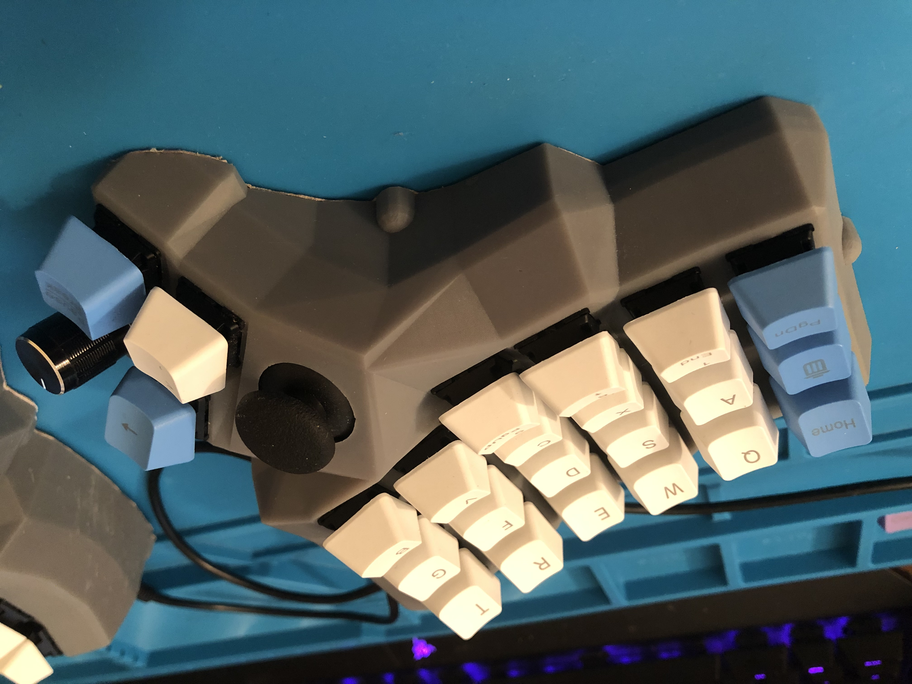

 

**Hi,**

this is my own little fork of the **dactyl manuform 4x6 keyboard** modified with a joystick. This repository describes only the changes necessary for a joystick. For the rest please look up one of the other building guides for the original dactyl manuform keyboards (the size (4x6, 5x6, ...) doesn't really matter, the principles are the same just make sure your chip is supported and has enough pins).

Feel free to ask anything. 

**Special thanks to:** 
[Leopold Dietrich](https://www.leopold-dietrich.de/) for help with the 3D prints. 
The [qmk developers](https://github.com/qmk/qmk_firmware) and the concerning [discord community](https://discord.com/invite/Uq7gcHh) for code and help. 

# Guide:

**1. Get the qmk firmware** 
Go to the [qmk github page](https://github.com/qmk/qmk_firmware), download the firmware and get it running.

**2. Copy the keymap folder into QMK** 
Copy [layoutScript/qmk/4x6/keymaps/joystick](/layoutScript/qmk/4x6/keymaps/joystick/) to
`~/qmk_firmware/keyboards/handwired/dactyl_manuform/4x6/keymaps/joystick`.
It contains `config.h`, `rules.mk` (enables the analog driver and Bootmagic) and the generated `keymap.c`.

**3. Adjust the joystick pins and settings** 
At the top of [basicData.c](/layoutScript/basicData.c) set `JOY_X_PIN` and `JOY_Y_PIN` to the analog pins your joystick is wired to.
The other settings can be tuned to taste:

| setting                 | default | meaning                                                                   |
| ----------------------- | ------- | ------------------------------------------------------------------------- |
| `JOY_DEADZONE`          | 15      | dead zone around the center in percent                                    |
| `JOY_INTERVAL_SLOW`     | 300     | ms between key taps at small deflection                                   |
| `JOY_INTERVAL_FAST`     | 25      | ms between key taps at full deflection                                    |
| `JOY_CURVE`             | 3       | response curve: 1 linear, 2 quadratic, 3 cubic (stays slow for longer)    |
| `JOY_VERTICAL_SLOWDOWN` | 150     | up/down repeats slower than left/right, in percent                        |
| `JOY_DIAGONAL_RATIO`    | 41      | how strong the weaker axis must be for a diagonal (41 = 8 equal sectors)  |
| `JOY_ROTATION_DEG`      | 20      | mounting rotation of the joystick, clockwise positive; compensated in software |
| `JOY_X_NEG` ... `JOY_Y_POS` | arrows | which arrow key each axis direction sends                             |

The center is calibrated automatically when the keyboard is plugged in, so don't touch the joystick while plugging it in.

**4. Configure your keyboard layout** 
Go to the [qmk layout configurator](https://config.qmk.fm/#/handwired/dactyl_manuform/4x6/LAYOUT), set up your layout and download the JSON file
(don't compile it there). You can also import the current layout
[layouts/linux_windows_layout.json](/layoutScript/layouts/linux_windows_layout.json), edit it and export it again.
Save it to [layoutScript/layouts](/layoutScript/layouts/).

**5. Set up the file paths** 
In [config.ini](/layoutScript/config.ini) `filepath_keymap` points to the `keymap.c` in your QMK keymap folder and
`filepath_layout` to the layout JSON. Relative paths are relative to the layoutScript folder.

**6. Run [transferLayout.py](/layoutScript/transferLayout.py)** 
It can be started from any folder; press ENTER twice to use the paths from `config.ini`: 
`python layoutScript/transferLayout.py`

**7. Flash the chip** 
`qmk flash -kb handwired/dactyl_manuform/4x6 -km joystick` 
When `Waiting for USB serial port` appears, unplug the left half and plug it in again while holding the top left key (Esc).
Bootmagic then starts the bootloader, no reset button needed. Only the left half (with the USB cable) needs to be flashed
for keymap changes.

**Notes**
- The USB cable always goes into the left half; it is detected as the left half automatically (no `EE_HANDS`).
- The joystick only works on the half with the USB cable.

# How does it work?:

1. The transferLayout script writes the joystick code ([basicData.c](/layoutScript/basicData.c)) into the QMK `keymap.c`.
2. It appends the layers from the layout JSON. The JSON uses the key order of the QMK configurator (standard `LAYOUT`);
   [wiring.json](/layoutScript/wiring.json) translates it to this keyboard's own matrix wiring
   (index = key position in the configurator, value = matrix positions `[row, col]`, empty list = key not built in).
   The thumb clusters of this build are wired differently from the standard dactyl, which is why this file exists.
   The keymap is written as a plain matrix, so no custom `LAYOUT` macro is needed.
3. In the firmware the joystick is read on every scan: the deflection is computed relative to the calibrated center,
   the mounting rotation is removed, and depending on direction and strength arrow keys are tapped
   (up to 8 directions, faster the further it is pushed).

# Data overview

| directory                      | description                                               |
| ------------------------------ | --------------------------------------------------------- |
| [3d_models](/3d_models/)       | containing the models for a 3d printer                    |
| [layoutScript](/layoutScript/) | combines your layout with the algorithms for the joystick |
| [pictures](/pictures/)         | some example and workflow pictures                        |
